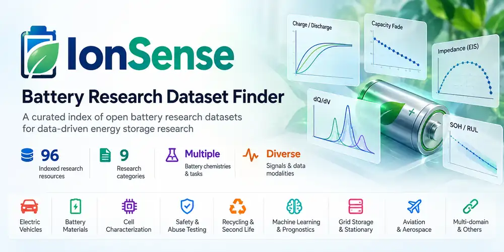

# IonSense — Battery Research Dataset Finder



*The banner depicts an earlier 96-resource milestone; the catalogue and counts below reflect the current 101-entry index.*

**Discover battery research resources across electric mobility, stationary energy storage, laboratory testing, diagnostics, safety, recycling, and specialised applications.**

[**Explore the Dataset Finder**](https://sakthigs.github.io/IonSense-Battery-Datasets/) · [**Compare datasets**](https://sakthigs.github.io/IonSense-Battery-Datasets/) · [**Coverage view**](https://sakthigs.github.io/IonSense-Battery-Datasets/?view=coverage) · [**Suggest a dataset**](https://github.com/SakthiGs/IonSense-Battery-Datasets/issues/new)

## About

IonSense is a **curated discovery catalogue**, not an EV-only dataset collection and not a host of third-party data. It helps researchers locate and compare links to battery datasets and associated research resources, then navigate to the original publishers and authors.

The current index contains **101 entries in 9 research categories**. It covers real-world battery telemetry, experimental cell testing, electrochemical characterisation, imaging, second-life studies, synthetic data and certain related code or model resources. **An indexed record does not automatically mean a downloadable or independently verified dataset.**

## What you can do

- **Discover** resources with text search and faceted filters for **application domain, research category, chemistry, research task, measurements and resource type**.
- **Compare up to three entries** side-by-side using the metadata available, including access status and documentation.
- **Explore coverage** by research task and catalogue category; switch among cards, table, and coverage views.
- **Inspect metadata coverage** for each search or filter result: chemistry labels reviewed against sources, records with licence metadata, and resources with an identified application domain. These counts describe catalogue documentation, not independently verified data access.
- **Review pending candidates** using the open GitHub Issues queue; discovered suggestions are not included in the catalogue until curated.
- **Visit original sources** and linked publications. Source owners retain control of their data and licensing terms.
- **Suggest corrections or new records** through GitHub Issues.

## Application domains vs research categories

**Application domain** describes an explicitly indicated end-use or context such as electric mobility, stationary storage, industrial/portable batteries, aerospace, or second-life and recycling. Many laboratory datasets do not specify a particular application; these remain **Not specified**, not automatically labelled EV. A dataset can relate to multiple application domains when the catalogue description supports them.

**Research category** describes the type or purpose of the record (for example ageing, state estimation, safety, imaging). It is separate from application domain.

### Current catalogue by research category

| Category | Entries |
|---|---:|
| Field & Real-World | 12 |
| Safety & Failure | 7 |
| Lab Aging & Degradation | 40 |
| State Estimation & Health Monitoring | 16 |
| Electrochemical Characterisation | 8 |
| Battery Imaging | 2 |
| Second-Life & Recycling | 3 |
| Aerospace & Specialised | 7 |
| Synthetic & Derived Battery Datasets | 6 |
| **Total** | **101** |

**New knee-point resource:** [Samsung INR18650-30Q Knee-Point Aging Dataset](https://data.mendeley.com/datasets/zn82y35zr8/4) (60 experimental cells, 9 ageing conditions, CC BY 4.0). The associated study examines knee points and second-life grading; the record does **not** provide validated knee-onset cycle labels for supervised prediction. The catalogue source contains the original dataset DOI and linked PNAS publication.

## Knee-onset and knee-point research

The catalogue links to **original sources** and documents which resources may be suitable for deriving knee-onset labels. A capacity-fade trajectory alone is **not** proof that a well-defined knee onset occurs, and a knee point is not identical to its onset. **None of the four newly added records is advertised as a fully validated, ready-labelled knee-onset benchmark.**

| Resource | Experimental or simulated | Knee-onset suitability |
|---|---|---|
| [Samsung INR18650-30Q, 60 cells](https://data.mendeley.com/datasets/zn82y35zr8/4) | Experimental | Direct knee-point study; derive onset labels separately and account for the post-80% SOH protocol change |
| [Chalmers NMC811, 5 simulated trajectories](https://data.mendeley.com/datasets/ry6g9cc5bw/1) | Synthetic | Explicitly cracking-induced knees; controlled test for onset-identification algorithms |
| [ICFormer, 2 real A123 LFP cells](https://github.com/nahuelcostac/ICFormer) | Experimental cases and accompanying simulations | Public real-cell knee examples; check data and software licences and sample-label conventions |
| [SNU dynamic-usage dataset, 130 cells](https://data.mendeley.com/datasets/npjy7vdgky/1) | Experimental | RUL and cycling data under variable charging; candidate for retrospective onset labels |
| [SNU LG MJ1 dataset, 81 cells](https://data.mendeley.com/datasets/p5vbbytz3x/1) | Experimental | Capacity retention and relaxation diagnostics; candidate for detecting transition to accelerated fade |
| [MIT–Stanford–TRI (MATR)](https://data.matr.io/1/) | Experimental | Previously indexed: original data for the [published knee-point/onset identification code](https://github.com/pfermined/knee_identification) |

For defensible BMS research, inspect full per-cell capacity trajectories, specify the knee-onset definition, quantify uncertainty when knees are weak or unobserved, and split by battery cell and preferably by cycling protocol to prevent leakage.

### Knee-onset evidence quality (source-audited)

IonSense maintains a **separate, machine-readable desk audit** at [`docs/knee_quality.json`](docs/knee_quality.json), reviewed 30 October 2026. It includes **nine** knee-relevant records, each linked to primary evidence, while preserving the distinction between source-confirmed knees, source-confirmed knee-onset studies, and ordinary unlabelled ageing datasets. The public dashboard has a **Knee evidence** filter and shows each audited record's label availability, capacity sampling resolution, study caveats, and next validation step.

| Evidence tier | Audited records | Correct interpretation |
|---|---:|---|
| Published knee-onset study | 2 | Published knee-onset analysis exists; **does not imply pre-labelled per-cell onset targets are downloadable** |
| Published knee-point study | 1 | Knee-point-specific measurements or analysis; knee onset is not interchangeable with the later knee point |
| Real-cell knee demonstration | 1 | Small experimental case study; insufficient for generalization claims |
| Unlabelled ageing candidate | 4 | Cycling/retention information exists; knee presence, prevalence and onset labels have **not** been established |
| Aggregate benchmark, not audited | 1 | Source overlap must be resolved before treating samples as independent |

**Not assessed** means we have not reviewed a dataset for knee-onset research; it does not mean the dataset has no knees. A desk audit is not a reproducibility or download test.

**Protocol for promoting any record to a validated knee-onset benchmark**

1. **Provenance:** download the original per-cell capacity data; record DOI/version, licence, raw-file hashes, unit and protocol details; never redistribute files without permission.
2. **Eligibility:** graph each cell's entire capacity-vs-cycle history, identify missing or repeated cycles, temperature/charge-protocol shifts and whether degradation is observable long enough to show a knee.
3. **Definitions:** report the mathematical knee-**onset** and knee-**point** definitions and parameters separately; compare at least two fitting methods (for example Bacon–Watts and degradation curvature) and report disagreement.
4. **Event uncertainty:** represent uncertain onset time with cycle intervals, and cells without an observed event as **right-censored/no confirmed knee**, not made-up knee dates; do not impose a knee at 80% SOH.
5. **Leakage control:** split by **cell**, preferably by batch, laboratory and cycling protocol; any labels estimated from the full curve are permitted only as *offline supervision*, never as online features.
6. **BMS usefulness:** withhold future data at inference time; evaluate error in cycles, lead time, false alarms, uncertainty calibration and whether a warning arrives early enough to alter operation.
7. **Promotion gate:** only mark labels **verified** when the derived target file, script, per-cell provenance, method parameters, inclusion and censoring rules, and independent verification are stored or publicly linked.

The automated validator [`scripts/validate_knee_quality.py`](scripts/validate_knee_quality.py) checks evidence category consistency and source-link integrity. **It cannot verify raw file correctness or physical knee-event truth.**


Category counts are for indexed **records**, not confirmed independent datasets or verified downloads. The index can include publications, repositories, code or model resources; potential overlaps and duplicates need source-level review.

## Data and website files

- [`docs/datasets.json`](docs/datasets.json) — structured catalogue and source URLs; metadata may be incomplete or provisional.
- [`docs/index.html`](docs/index.html) — the static GitHub Pages explorer, including filtering, comparison and coverage views.
- [`metadata/`](metadata/) — separate research-oriented quantum-readiness metadata and example tables; do not interpret its scores as experimentally proven quantum advantage.
- [`scripts/check_links.py`](scripts/check_links.py) — link-checking utility; HTTP reachability alone does not establish downloadable data or rights to reuse.
- [`CONTRIBUTING.md`](CONTRIBUTING.md) — contribution guidance.

**Running the finder locally:** from the repository root, run `python3 -m http.server 8000` and open `http://localhost:8000/docs/`. GitHub Pages is published from `main /docs`.

## Metadata quality and research cautions

1. **Original sources first.** Read the dataset owner's description, licence, documentation, and associated papers before using or redistributing data. Cite **the original dataset creators**.
2. **Application labels are provisional.** The new application filter is based on information already present in the catalogue; it has **not** been independently verified for all 101 records. Uncertain end-uses are marked **Not specified**.
3. **Chemistry is not guessed.** An unknown cathode chemistry is not inferred merely from lithium-ion or from a battery product name.
4. **Access is not guaranteed.** Links may lead to a paper, software repository or landing page rather than raw measurements. An accessible URL is not proof that a dataset can be downloaded or reused.
5. **Synthetic data is identified as such.** For example, MagBridge-Battery is a synthetic research resource, not an experimental magnetometry recording.
6. **Potential classification conflict:** the indexed “Electric Vehicle Usage Data Set for Battery Aging Studies” entry describes portable 24 V systems. Its application domain is left unassigned pending verification at the original source.

## Contributing

We welcome dataset suggestions, corrections to domain or chemistry labels, source updates, missing licences and documentation, and reports of duplicate or unavailable records. Please [open a GitHub issue](https://github.com/SakthiGs/IonSense-Battery-Datasets/issues/new) and include a link supporting the requested change. See [CONTRIBUTING.md](CONTRIBUTING.md).

## Citing IonSense

If IonSense helped you find or compare datasets, please cite:

> Gunasekar, S. P., & Rangarajan, P. K. (2026). *IonSense-QKG: A Quantum-Readiness Metadata Framework for Lithium-Ion Battery Dataset Discovery.* arXiv:2607.01286. https://arxiv.org/abs/2607.01286

```bibtex
@misc{gunasekar2026ionsenseqkg,
  title         = {{IonSense-QKG}: A Quantum-Readiness Metadata Framework for Lithium-Ion Battery Dataset Discovery},
  author        = {Gunasekar, Sakthi Prabhu and Rangarajan, Prasanna Kumar},
  year          = {2026},
  eprint        = {2607.01286},
  archivePrefix = {arXiv},
  primaryClass  = {cs.LG},
  doi           = {10.48550/arXiv.2607.01286},
  url           = {https://arxiv.org/abs/2607.01286}
}
```

Please also cite the original creators of every dataset you use. Machine-readable metadata is in [`CITATION.cff`](CITATION.cff).

## Licensing and attribution

Repository code is distributed under the terms in [LICENSE](LICENSE) (GNU GPL v3). **Third-party datasets, source material, images, publications and linked resources retain their respective original licences**; this repository licence does not override them. This directory does not rehost the third-party datasets.
